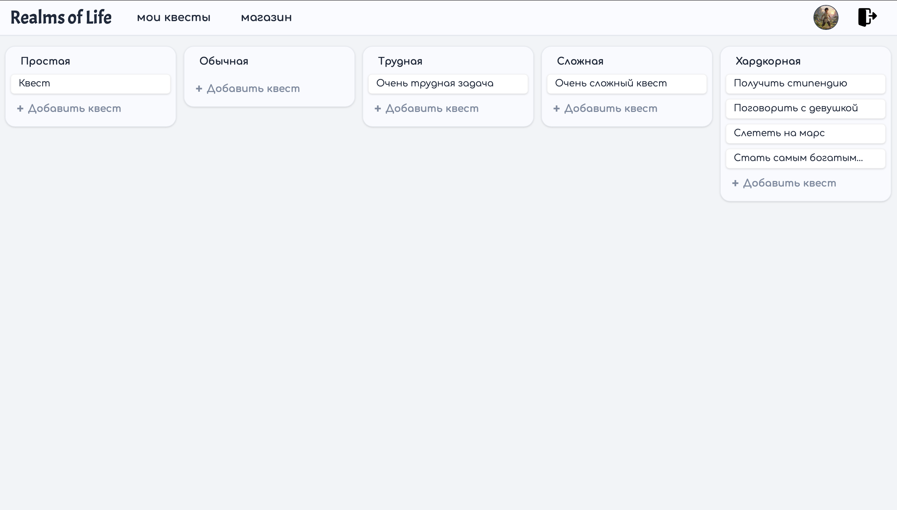
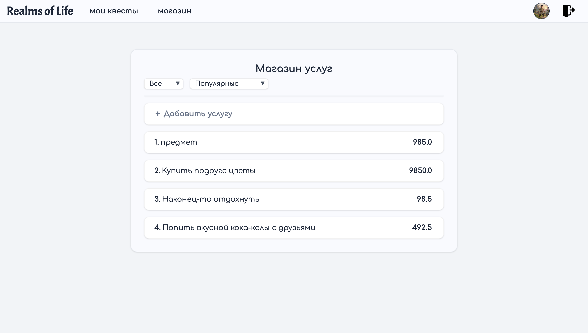
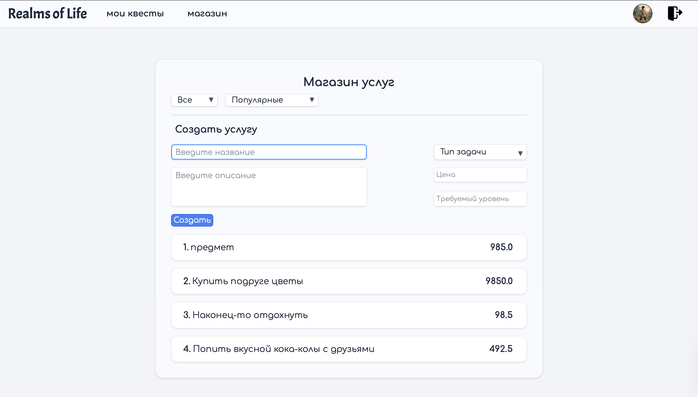
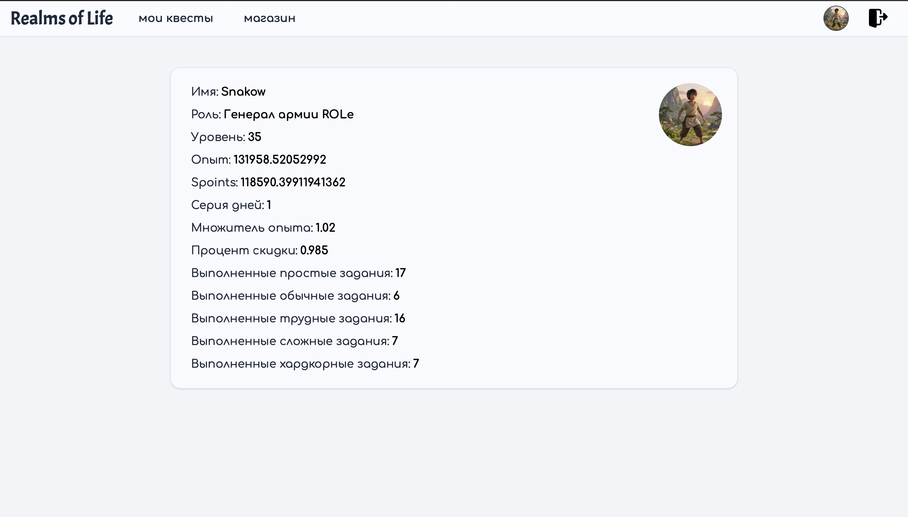

# Realms Of Life(ROLe)
 
  
  
____
#### **🚀Игра, в которой ты можешь стать продуктивней**

> **Языки:** RU

В игре есть все для улучшения твоего **🎮РЕАЛЬНОГО игрового процесса**:
- Canban-доски
- Магазин с кастомными товарами
- Полная статистика всех действий
- Достигаемая персонализация

#### План недели

Вкладка **«План недели»** показывает семь календарных колонок с понедельника по
воскресенье. Стрелки переключают недели, а кнопка «Сегодня» возвращает текущую.
Заголовки задач отображаются полностью; нажатие открывает описание и редактирование
в модальном окне. Время расписания указывается по Москве.

**Цели** хранят недельные задачи отдельно от колонок. В дни добавляются их части,
а прогресс цели показан полоской с отдельным сегментом для каждой части.
Отмена выполнения возвращает прогресс; отменённую часть можно восстановить из цели.

Для задачи можно выбрать доску квестов: тогда с начала назначенного дня она
появится в квестах и получит награду по правилам выбранной доски. Выполнение и
отмена синхронизированы через один связанный квест. Без доски задача остаётся
обычным пунктом плана без XP и Spoints. Отдельная награда за цель не начисляется.

**Повторение и перенос на следующую неделю:** по умолчанию записи повторяются
еженедельно, с новым статусом выполнения и отдельной историей. При редактировании
можно изменить только выбранную запись или её последующие повторения. Кнопка
«На следующую неделю» также копирует разовые задачи и цели, сохраняя уже внесённые
изменения следующей недели и не создавая дубликаты. Шедулер готовит текущую и две
следующие недели; более далёкая неделя подготавливается при её открытии.

<br>

#### 📋Canban-доски:

> Удобная визуализация твоих задач, которые ты поставил

##### Есть 5 категорий досок(в дальнейшем будут кастомные):
- **Простые**(срок действия **1 день**) – 20 Spoints, 20 xp + бонусы
- **Обычные**(срок действия **1 день**) – 50 Spoints, 50 xp + бонусы
- **Трудные**(срок действия **неделя**) – 200 Spoints, 200 xp + бонусы
- **Сложные**(срок действия **месяц**) – 500 Spoints, 500 xp + бонусы
- **Хардкорные**(без срока) - 5000 Spoints, 5000 xp + бонусы

Однодневные квесты можно отметить до **12:00 следующего дня по Москве**.
Недельные, месячные и бессрочные квесты сохраняют сроки своих досок.
Сервер проверяет просроченные задачи при запуске и затем раз в минуту;
перед выполнением квеста срок проверяется отдельно, без ожидания фоновой проверки.
Страница квестов обновляется раз в минуту, пока открыта, а также при возвращении
во вкладку и восстановлении сети. Запланированные квесты появляются с указанной
даты (дата без времени означает полночь по Москве).

##### Бонус за повышения уровня:
- 200 Spoints

##### Бонус за последний выполненный квест:
- **+50%** к Spoints

##### Недельный бонус(все закрытые трудные квесты):
- 150 Spoints
- 2% к множителю Spoints(действует к бонусам за квесты)
- 1.5% к скидке в магазине
- Множители и скидки увеличиваются в **геометрической прогрессии**(если к 200% множителю прибавляются 2%, то это уже не 2, а 4%)

##### Серия дней(days streak)
За выполнение любого квеста за день, серия дней **увеличивается на 1**

##### Наказание за невыполнение квестов
- Сбрасывается серия дней, если не выполнил ни одного квеста
- Сбрасывается недельные множители и скидки, если за 2 недели не выполнил недельный план трудных задач

___

___

#### Магазин кастомных товаров и не очень

Здесь можно купить кастомные товары, которые **ты можешь создать сам**. Пока здесь можно купить только свои, но с обновлениями, здесь можно будет взять и другие предметы.

В магазине используется валюта, называемая **Spoints**

___



___

#### Профиль, самое важное

Spoints, выполненные квесты, уровень, xp, все здесь есть

Кстати, забыл упомянуть о системе ролей, с повышением уровня, есть шанс, что роль повысится, самая наивысшая роль - **легенда ROLe**

___

___

### Автоматические проверки GitHub Actions

Workflow `.github/workflows/deploy.yml` запускается при push в `main`,
pull request в `main` и вручную через Actions → ROLe CI → Run workflow.
Он запускает тесты backend, тесты и сборку frontend, затем собирает Docker-образы
и проверяет запуск MongoDB, backend, nginx, страницу `/plan` и проксирование `/api/`.
При ошибке запуска выводятся статус контейнеров и их логи.

Проверки используют тестовые настройки и отдельный том MongoDB на временном
GitHub runner. После проверки удаляются только контейнеры и том этого CI-проекта.
Локальные данные не затрагиваются. Публикация сайта и образов отключена;
добавлять secrets для CI не требуется.

### Установка ROLe в Docker-контейнер

> **ROLe** - это не какой либо сайт, который хранит твои данные, это твое **собственное локальное приложение**

#### 1. Устанавливаем Git(если ещё не установили)

#### 2. Клонируем репозиторий

> Для этого подбираем желаемую папку и прописываем:

Заходим в терминал ОС и переходим к выбранной папке и пишем команду:

```terminal
git clone https://github.com/Snakow-creator/ROLe.git .
```

#### 2.1 (по желанию) Меняем конфигурацию backend/.env.docker

Можно здесь поменять адрес коллекции, и JWT-токен, но его можно не менять, если использовать его в локальной сети

Docker использует базу из `COLLECTION_NAME`. Адрес MongoDB внутри Docker —
`mongodb://mongo:27017`; локальный запуск использует отдельный файл `backend/.env`.

#### 3. Устанавливаем Docker

Для Docker-образа, не для Linux, подойдет [Docker-Desktop](https://www.docker.com/products/docker-desktop/)

#### 4. Устанавливаем контейнер

В терминале пишем:

```terminal
docker compose build
```

#### 5. Запускаем контейнер

В терминале пишем

```terminal
docker compose up -d --build --wait --wait-timeout 180
```

Приложение доступно по адресу http://127.0.0.1:4173.
Compose ждёт готовности MongoDB и backend перед запуском зависимых сервисов.
Порты MongoDB и backend доступны только внутри Docker, поэтому локальную версию
можно запускать параллельно на 5173 с backend на 8111 и MongoDB на 27017.
После изменения кода повторите эту же команду для пересборки образов.


<br>

#### Если выхотите упростить способ запуска контейнера

##### Для MacOS(Automator)

> Данный скрипт позволяет одним кликом запускать Docker, запускать контейнеры и **открывать страницу с ROLe**
(почти как полноценное приложение)

1. Создаем новый файл и выбираем **Application**
2. Выбираем в Library **Utilities** и нажимаем справа **Run Shell Script**
3. Выбираем режим `/bin/bash` если он не выбран
4. Копируем код и изменяем нужные значения

```shell
# 1. Запуск Docker Desktop, если не запущен (без показа окна)
if ! /usr/local/bin/docker info >/dev/null 2>&1; then
	open --hide --background -a Docker
fi

# 2. Ждём, пока Docker запустится (проверяем сокет)
until /usr/local/bin/docker info >/dev/null 2>&1; do
    sleep 2
done

# 3. Переход в проект
cd 'путь к проекту' || exit 1

# 4. Пересборка и запуск контейнеров с ожиданием готовности
/usr/local/bin/docker compose up -d --build --wait --wait-timeout 180 || exit 1

# 5. Открытие сайта
open "http://127.0.0.1:4173"

exit 0
```

**Важно!**

Если твой проект находится в **защищенных папках MacOS**:

- Documents
- Desktop
- Downloads
- iCloud Drive
- External drives
- Network volumes

MacOS после перезагрузки один раз будет запрашивать разрешение на чтение файлов.
Чтобы не MacOS не запрашивал разрешение, проект можно не сохранять в данных папках.
